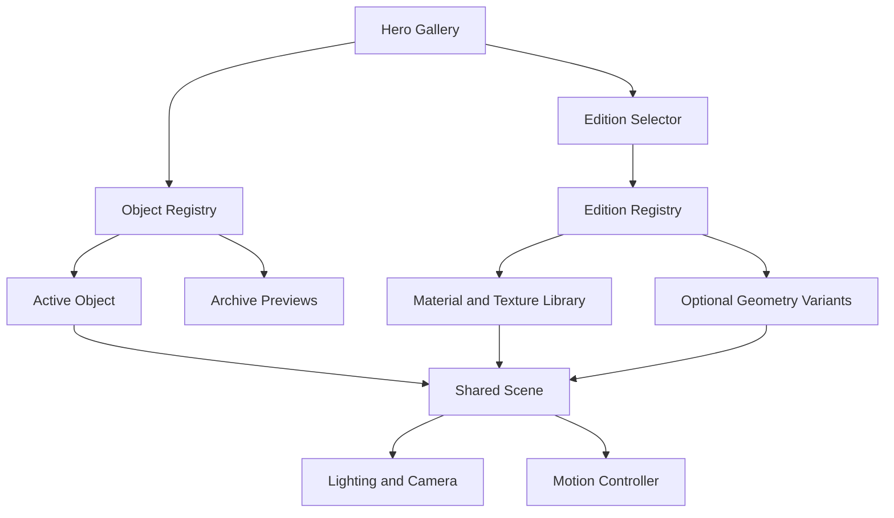

# TING — The Maker's Studio

> Design specification · Revision 2 — Object Design Editions  
> Baseline: Task 004 / Object Collection  
> Next milestone: Task 005 / Maker Console Editions

This document defines the long-term visual direction, interaction contract, 3D quality standard and development roadmap. Individual implementation scope and acceptance details belong in the corresponding task files. The current specification supersedes conflicting historical requirements from Tasks 001–004; earlier task files remain engineering references.

## 1. Creative direction

**Industrial Design Portfolio × Digital Museum**  
**Soft Industrial Craft / Retro Tech Minimalism**

A personal exhibition, not a SaaS template, online shop or hardware sales site. The site should feel like a curated industrial design archive, with carefully designed objects that express the person behind them.

The central metaphor is **Disassemble → Understand → Reassemble**. It represents curiosity, craftsmanship, accounting, workflow optimisation and intelligent automation.

TING is an accounting professional with five years of work experience in Japan, currently preparing for CPA, interested in RPA, AI, Game Boy assembly, leather notebook craft and retro photography. The Accounting Maker brand is a shared initiative. Do not claim CPA certification or completed client projects without evidence.

### Visual references

- https://recent.design/i/jxpvlxl-ai-generated-macro-pad-3d-model
- https://recent.design/i/qkfor3e-3d-product-explorations

Use these for product composition, quality of surfaces, lighting, visual hierarchy and mechanical motion. Do not directly replicate the referenced designs or imply affiliation with manufacturers.

## 2. Visual system

| Token | Value |
| --- | --- |
| Gallery paper | `#F4F3EE` |
| Ink | `#20211F` |
| Muted text | `#64665D` |
| Accent | `#D35C37` |

- Oversized editorial sans-serif typography, tight tracking, small monospace exhibition labels, generous negative space, fine rules and asymmetric compositions.
- Large real-time 3D objects are the primary visual focus. Preserve adequate separation between the hero title, object, metadata and controls.
- Warm neutral exhibition background; dark contrasting About and Collaboration sections; light editorial Work and Collection sections.
- Avoid generic rounded SaaS cards, gradients, stock icon grids, neon lighting, excessive bloom, decorative particles and toy-like geometry.
- The UI should remain quiet even when an object's material or silhouette is expressive. Do not recolour the whole website when an edition changes.

## 3. Information architecture

1. **Opening exhibition:** The Maker's Studio — four objects sharing one full-viewport horizontal gallery. Default: OBJECT 001, assembled, default edition.
2. **About:** Hello, I'm Ting. Accountant. Maker. Curious mind. Include Japan experience, CPA in progress, accounting, automation and personal interests.
3. **Work:** Accounting workflows, RPA and AI explorations. Distinguish offered services from verified completed work.
4. **Collection:** Objects of curiosity — a compact visual index of the four exhibits, with preview images of the actual models, object numbers, names and short descriptions. Clicking an image or Explore object returns to the corresponding hero exhibit. Do not duplicate full-sized live 3D scenes in this section.
5. **Collaboration:** AI, automation, better workflows. Real contact details must be supplied before enabling contact CTAs. Do not invent email addresses or dead links.

Identity tags: Accounting Maker, Automation Crafter, AI Explorer, Workflow Optimizer, Systematic Thinker, Retro Tech Lover, Leather Crafter, Film Photography Enthusiast, Japan Experience, CPA in Progress.

## 4. Object collection and design editions

An **Object** represents a distinct physical product and personal interest. An **Edition** represents an alternative industrial design of that same object. These are two independent dimensions of navigation.

Each object will initially have three selectable editions. Future editions can be added without changing the other objects or the website layout. An edition is not a separate exhibit, page or mandatory scroll chapter.

### OBJECT 001 — Maker Console

**Accounting · Automation · AI**

Original retro-inspired device combining a mechanical macro pad, calculator elements, LCD, physical rotary knob and tactile keys. Retain its six-key functional identity, olive AI and terracotta RUN accents where appropriate, and original assembly structure.

| Edition | Art direction | Distinctive details |
| --- | --- | --- |
| 01 · Frosted Polycarbonate (default) | Warm ivory, translucent frost, olive and terracotta | Real shell thickness, softened translucency, visible internal components, tactile keycaps and crisp LCD |
| 02 · Brushed Aluminium | Satin silver CNC-style body, contrasting keys | Directional brushed grain, machined chamfers, metal encoder, precise fasteners and seams |
| 03 · Anodised Graphite | Dark graphite metal, restrained accents | Fine bead-blasted/anodised finish, readable legends, contrasting metal edges and subtle reflections |

Independently manipulable groups: bottom enclosure, PCB and components, top enclosure, LCD, mechanical switches, keycaps, rotary encoder, screws/connectors. Preserve existing Motion Studio capabilities.

### OBJECT 002 — Game Boy

**Curiosity · Assembly · Retro Tech**

Retro handheld assembly study; no implied manufacturer affiliation.

| Edition | Art direction | Distinctive details |
| --- | --- | --- |
| 01 · Classic (default) | Warm grey/ivory moulded plastic, muted burgundy controls | Recognisable handheld proportions, recessed display, D-pad, A/B controls, speaker grille, battery door and cartridge |
| 02 · Transparent | Translucent tinted shell, proposed atomic purple | Visible PCB, fasteners, ribs, shell thickness and layered internal parts |
| 03 · CNC Machined | Silver machined aluminium | Brushed or bead-blasted housing, clean chamfers, functional openings and metal/plastic contrast |

Disassembly should reveal coherent internal layers, with front/rear housing, screen, controls, PCB and cartridge moving along meaningful assembly axes.

### OBJECT 003 — Leather Journal

**Craftsmanship · Patience · Details**

Handcrafted leather notebook with believable cover construction, paper block, spine, stitching and closure.

| Edition | Art direction | Distinctive details |
| --- | --- | --- |
| 01 · Cognac (default) | Vegetable-tanned warm brown leather | Natural grain, layered cut edges, warm thread, cream paper |
| 02 · Noir | Black fine-grain leather | Controlled highlights, contrasting or tonal thread, dark hardware |
| 03 · Vintage Patina | Proposed dark olive aged leather | Localised wear, organic colour variation, subtle creases, aged brass closure |

The primary motion is opening the cover around the actual spine hinge. Paper and closure should behave plausibly; do not force an electronic exploded-view metaphor onto the notebook.

### OBJECT 004 — Film Camera

**Observation · Perspective · Memory**

Original retro analogue camera study with recognisable body, lens barrel, optical elements, shutter control, film advance, viewfinder and adjustment dials.

| Edition | Art direction | Distinctive details |
| --- | --- | --- |
| 01 · Silver Chrome (default) | Silver metal and dark leatherette | Layered metal finishes, leatherette grain, knurled rings and optical reflections |
| 02 · Matte Black | Dark matte body and lens | Subtle material contrast, legible engraved markings, satin control surfaces |
| 03 · Heritage Brass | Black-painted aged brass | Localised exposed brass at high-wear edges, fine patina and restrained weathering |

Reveal lens assemblies and camera construction through purposeful motion. Keep optical parts, lens rings and relevant body assemblies independently named.

The edition names and detailed palettes above are proposed art directions. They may be refined during each object's visual review; do not sacrifice quality to preserve a provisional colour choice. The required scope is three genuinely differentiated editions per completed object.

## 5. Interaction contract

### 5.1 Object navigation — horizontal gallery

- All four objects occupy the same hero exhibition position. The heading, gallery structure and page scroll remain stable.
- Previous/next arrows, numbered object indicators and touch swipe outside the model support object navigation. The incoming exhibit moves in the appropriate horizontal direction; aim for a restrained coordinated outgoing transition when feasible.
- Default order: Maker Console → Game Boy → Leather Journal → Film Camera. No autoplay and no requirement to visit every object before About.
- Update object name, number, tags, edition options and model together. Avoid stale controls from the previous object.
- Keep object switching distinct from drag-to-orbit and vertical scrolling. Do not bind an ordinary mouse drag on the 3D model to slide navigation.

### 5.2 Edition navigation — material and design selector

Add a compact, reusable **Design Edition Selector** within the current hero. Place it near the object metadata without competing with the 3D canvas or horizontal gallery controls.

Example:

```text
OBJECT — 001
Maker Console
Accounting · Automation · AI

DESIGN EDITION  02 / 03
[ Frosted ] [ Aluminium ] [ Graphite ]
Brushed Aluminium

←  001  002  003  004  →
```

- Use small material swatches or previews with readable names, a visible selected state and keyboard-accessible buttons. Colour alone must not identify an edition.
- Each object owns its edition options; avoid a universal palette that applies the same materials to all objects.
- Switching an edition updates the actual 3D materials, textures and edition-specific geometry/details, not an image overlay.
- Keep camera/orbit angle, object scale, page position and normalised motion progress when changing editions. Do not remount the canvas merely to change material.
- Remember each object's last selected edition during the current page session; on a fresh visit start at the default edition. Persistent storage is optional, not required.
- Objects not yet upgraded remain on their existing single edition. Hide the selector when only one edition is available; never expose placeholder or nonfunctional options.
- No compulsory animations or autoplay on edition selection. Use a brief restrained transition where it can be done without visual glitches or resetting interactions.

### 5.3 Model inspection and scroll motion

- Mouse drag rotates the active model. Wheel scroll moves the page rather than zooming the camera. Touch users retain normal vertical scrolling; touch inspection must not conflict with navigation.
- Sticky canvas is limited to the opening chapter. Scroll drives the current object's motion from 0 to 1, followed by the About section. Reverse scroll naturally reverses the motion.
- No compulsory reassembly before About and no additional mandatory pinned chapters for other objects or editions.
- Maintain stable framing as the object opens or explodes. Preserve all meaningful parts in view; do not allow clipping or excessive camera movement.
- Preserve exact assembled transforms, meaningful component names and local origins. Use Y-up for existing procedural assemblies and consistent motion axes.
- Preserve `/playground` inspection controls, including key press, rotary interaction, LCD boot and exploded-view/reassembly timeline. Do not impose playground-only controls on the public landing page.
- Reduced-motion users see static assembled models or a descriptive fallback. The main content remains accessible HTML.

## 6. Product fidelity and rendering quality

The initial procedural models are structural prototypes. The next phase is product-quality refinement. A different colour or a single metalness adjustment does not count as a distinct high-quality edition.

### Geometry

- Refine silhouettes, proportions, bevel radii, edge transitions, gaps, seams, tolerances, thickness, actual openings, fasteners and recognisable functional details.
- Use real geometry for silhouette-defining features and moving parts. Use normal/bump textures for small surface details that do not affect silhouettes.
- Avoid exposed intersections, floating parts, impossible construction and large featureless boxes. Inspect each model from the front, back, side and three-quarter views.
- Share geometry when it truly represents the same construction; allow edition-specific shell shapes, keycaps, lens rings, closures or trim when needed. Do not force all editions to have identical geometry.

### Physically based materials (PBR)

| Surface | Required treatment |
| --- | --- |
| Brushed metal | Directional fine grain, anisotropic reflections where supported, appropriate metalness and roughness, precise edge highlights |
| Anodised metal | Fine satin or matte finish, subtle surface variation, believable distinction from black plastic |
| Moulded plastic | Nonmetallic response, fine moulded grain, plausible sheen and seams |
| Frosted/transparent polymer | Transmission, IOR, roughness, real shell thickness, controlled visibility of interior parts |
| Leather | Natural grain, micro-normal detail, local roughness/colour variation, stitching and cut edges |
| Paper | Layered page edges, nonmetallic rough surface, subtle fibres and natural off-white tones |
| Optical glass | Curved layered elements, plausible reflections/refraction and coating tint; distinguish from opaque painted discs |
| Aged surfaces | Localised wear and patina consistent with handling, not uniform random noise |

Use base colour, roughness, normal/bump, metalness and ambient occlusion maps as appropriate. Not every material needs every map. Use correct colour spaces: colour/emissive textures in sRGB; data maps in linear/no colour space according to the renderer. Ensure consistent UVs and realistic texture scale. Configure transmission, IOR, clearcoat and anisotropy only where physically justified.

### Lighting and presentation

- Use a shared product photography studio with broad softbox key lighting, controlled fill, rim highlights, environment reflections and soft contact shadows.
- Use an HDRI or deliberately arranged studio lightformers to make reflective surfaces visibly metallic. Metalness alone is insufficient.
- Keep exposure and tone mapping consistent across editions; avoid blown highlights, crushed blacks, excessive bloom or mirror-like plastic.
- Each object's default camera angle should showcase its recognisable features and material. Allow per-object framing but maintain a coherent visual size within the hero.
- Archive thumbnails should depict the actual model's default edition, not generic stock photographs. The selected edition must be identifiable in the hero; do not render all twelve edition previews on initial page load.

## 7. Technical architecture

Retain Next.js, TypeScript, Three.js, React Three Fiber and `@react-three/drei`. Preserve the existing motion controller and static export architecture; do not introduce a backend or new framework for this feature.



### Design boundaries

- Object Registry: stable object ID, metadata, default edition ID, available editions and model entry point.
- Edition Registry: stable edition ID, name, swatch, material presets, optional texture assets and geometry options.
- Material/Texture Library: reusable physical material definitions, texture loading, caching and cleanup. Material instances must not accidentally share mutable state between editions.
- Scene: camera, studio environment, controls, render loop and current object. Keep one active main hero canvas; preserve orbit and motion progress on edition change.
- Model: named assembly groups with a clear interface for edition-dependent styling/geometry. Maintain existing motion compatibility; rebind named parts and reapply progress if a geometry variant replaces meshes.
- Archive: lightweight still images generated from actual default-edition models; prefer cached or pre-rendered assets where reliable. Runtime capture is acceptable if bounded and disposed after capture.

Suggested implementation shape (illustrative, not a mandatory file layout):

```ts
type ObjectId = "001" | "002" | "003" | "004";

type Edition = {
  id: string;
  name: string;
  swatch: string;
  materialPreset: string;
  geometryVariant?: string;
};

type Exhibit = {
  id: ObjectId;
  defaultEditionId: string;
  editions: Edition[];
};
```

### Procedural geometry vs external assets

Retain procedural Three.js geometry when it meets the quality target and supports motion. Blender/glTF/GLB is an optional route for complex forms, accurate UVs or detailed material work that is impractical in code. Imported assets must retain independently addressable moving parts and documented scale, axes, naming, texture licences and source. Do not replace the interactive hero with a static render or GIF.

External assets must be licence-verified and locally bundled when needed. Do not rely on hotlinked third-party textures or remote assets that break static hosting. Use basePath-compatible asset URLs and verify the deployed site, not just localhost.

## 8. Performance and accessibility

- Aim for 60 FPS on capable desktops and at least 30 FPS on supported mobile devices, measured on representative hardware rather than asserted without tests.
- Bound DPR, texture sizes and geometry complexity. Load the active edition first; prefetch neighbouring assets only when useful. Avoid simultaneously mounting twelve real-time scenes.
- Use demand rendering when idle; pause unnecessary off-screen rendering. Dispose replaced geometry, textures and materials when no longer referenced.
- Prevent stale asynchronous asset loads from overwriting the currently selected edition. Show a restrained loading/fallback state if necessary.
- Keyboard-operable edition and object controls, accessible names, selected state and visible focus indicators. Preserve normal page navigation and legible content without WebGL.
- Respect `prefers-reduced-motion`; provide a static fallback or descriptive text if rendering is unavailable.
- Verify desktop and mobile layout, normal scroll, swipe and drag. No overlapping controls or text/model collisions.

## 9. Development roadmap — one object at a time

Do not implement all twelve editions in parallel. Complete and visually approve the three editions of one object before moving on. Shared infrastructure is developed incrementally as required, not as a separate speculative platform project.

| Task | Scope | Completion gate |
| --- | --- | --- |
| 001 | Maker Console geometry and playground | Historical baseline |
| 002 | Motion Studio | Historical baseline |
| 003 | Landing Page V1 | Historical baseline |
| 004 | Four-object horizontal collection and archive previews | Current baseline |
| 005 | Maker Console: three editions; reusable edition selector, registry and shared rendering/material foundations | All three versions visually approved, interactions preserved, build passes |
| 006 | Game Boy: three editions, using/refining Task 005 foundations | All three versions visually approved; Maker Console regression checks |
| 007 | Leather Journal: three editions and credible leather/paper/hinge detail | All three versions visually approved; prior-object regression checks |
| 008 | Film Camera: three editions and credible metal/glass/lens detail | All twelve editions available; full-site regression checks |

Suggested task documents: `tasks/task5.md`, `tasks/task6.md`, `tasks/task7.md`, `tasks/task8.md` (follow the repository's actual task naming convention). Create the next task only when the preceding task has established the required design quality. Each task must identify its own assets, implementation scope, tests and open issues.

Suggested feature branches, based on the latest accepted code:

- `task5-maker-console-editions`
- `task6-gameboy-editions`
- `task7-journal-editions`
- `task8-camera-editions`

Branch and merge policy should follow the current repository workflow. Do not assume historical task branches still exist. Do not change the production deployment target without explicit approval.

## 10. Per-object acceptance criteria

A task is complete only when the following have been verified for its three editions:

- [ ] Each edition has a coherent, recognisable industrial design and a visibly distinct material/design identity; not merely a colour change.
- [ ] Product geometry, physical thickness, small details, materials, reflections and shadows are convincing at intended hero scale and from multiple angles.
- [ ] Actual model materials/geometry update through the selector. No placeholder controls or duplicated navigation.
- [ ] Camera orientation and scroll progress remain stable when switching editions; rapid switching does not leave stale meshes or textures.
- [ ] Object switching, reverse scroll, orbit and existing playground controls still work. All moving components return to their assembled transforms.
- [ ] No obvious unintended mesh intersections, clipping, broken texture coordinates or missing assets.
- [ ] Desktop/mobile screenshots of all three assembled editions and representative opened/exploded views are captured for visual review under comparable lighting.
- [ ] Mobile layout, reduced-motion and WebGL fallback are verified; performance is measured and reported.
- [ ] Lint, TypeScript, production build and GitHub Pages static export pass using repository scripts and configuration.
- [ ] Previously accepted objects/editions remain functional; archive thumbnails match the actual models.
- [ ] Remaining visual or technical issues are documented. Owner visual approval is required before treating a model as finished or deploying it as an approved release.

## 11. Deployment and engineering references

Production home remains `/`; retain `/playground` and GitHub Pages static export compatibility. A successful compilation alone is not a deployment or a visual acceptance test. Check the actual deployment status and URL when publishing is explicitly requested.

Historical specifications and engineering notes remain available in the existing task files and `MOTION.md`. The original six-key Maker Console uses rounded extruded geometry, real holes, curved custom keycaps, machined cylindrical details and independently named groups; the profile-based Motion Studio stores assembled transforms and applies reversible timelines. Preserve these capabilities as the model is refined. The historical entrance/idle/pointer motion concepts are optional art-direction references, not new mandatory features for Tasks 005–008.

### Technical and asset references

- Three.js MeshPhysicalMaterial: https://threejs.org/docs/pages/MeshPhysicalMaterial.html
- Three.js MeshStandardMaterial: https://threejs.org/docs/pages/MeshStandardMaterial.html
- Three.js color management: https://threejs.org/manual/en/color-management.html
- React Three Fiber performance: https://r3f.docs.pmnd.rs/advanced/scaling-performance
- Poly Haven (HDRI and textures): https://polyhaven.com/
- ambientCG (PBR materials): https://ambientcg.com/
- Blender: https://www.blender.org/

Verify the specific asset licence and installed library documentation before use.
